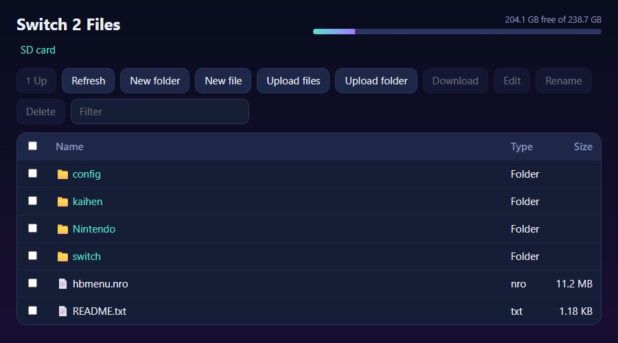

# Web file manager for Switch 2

**A web file manager for the SD card of a Nintendo Switch 2, as a kaiHEN plugin that starts at boot.** Open it in a browser on the same network. There is nothing to start by hand and no FTP client to set up.

It is a plugin, not a homebrew menu program: it runs in the background from the moment kaiHEN starts, listens on port **8888**, and keeps running while you play. The source code is in this repository and the plugin is on the [Releases](../../releases) page.

## Features
- Browse the whole SD card, with sorting and a filter
- Upload files or whole folders: pick them or drop them on the page, with progress and speed
- Download, rename, delete (folders too), new folder, new file
- Edit text files up to 1 MiB in the page
- Free space of the card
- Uploads go to a temporary `.wfm-part` file that replaces the target when the last byte has arrived, so an interrupted upload leaves nothing half written
- Works from a phone, a tablet or a PC browser

## Install
1. Download `webmanager-nx2-1.0.0.zip` from the [Releases](../../releases) page and unzip it onto the root of the console's SD card. It puts `webfm.nso` in `kaihen/plugins/`.
2. Restart the console and kaiHEN. `/kaihen/plugin-status.txt` should list `webfm: running`.
3. Open `http://<console IP>:8888` in a browser on the same network.

To remove it, delete `/kaihen/plugins/webfm.nso` from the card.

Step-by-step guide: [INSTALL.md](INSTALL.md).

## Safety
There is no password. Use it only on a network you trust.

A page of another web site cannot change anything on the card: every change needs the header `X-Webfm: 1`, which a browser does not send across sites, and every request must name the console by its IP address in the Host header, which stops DNS rebinding (host names are refused). Paths with `..` are refused.

The plugin only sees the SD card. It does not open internal storage or save data.

Up to 3 connections at once; a fourth gets `503`.

## Known limits of the console
- Files with non-ASCII names (accents, Cyrillic, emoji) are not shown in folder listings: the console's file system leaves them out without an error. They still exist and can be read, written, renamed and deleted by name. FTP servers on the console have the same limit.
- Japanese and other CJK names cannot be created, and `"` is not allowed in a name (exFAT).
- A plugin that fails to start can stop kaiHEN from starting the plugins after it. If that happens, take the SD card out and delete `webfm.nso`.

## Tests
- `make test` runs the host tests of the request parsing and path handling.
- `tests/device_test.py CONSOLE_IP` runs 59 end-to-end checks against a real console: every endpoint, error cases, 20 and 100 MB files, three parallel downloads, abuse of the protocol, a stalled client, and folders with 900 entries. It works in a throwaway folder and removes it.
- `tests/mock_server.py FOLDER` serves the same API from a PC folder, to try the page in a browser.

Measured on a console: about 8 to 13 MB/s upload and 21 MB/s download, over Wi-Fi.

## Build
See [BUILDING.md](BUILDING.md).

## Credits and licences
- [kaiHEN](https://github.com/ouncebrew/kaihen) and the [ounce-devkit](https://github.com/ouncebrew/ounce-devkit) by ouncebrew.
- The plugin structure follows the plugin runtime documented in kaiHEN's `libkaihen/PLUGINS.md`. The `ftpd` plugin by NerdsMcGee showed what a plugin that serves several clients looks like.

This project is released under the MIT licence (`LICENSE`).
